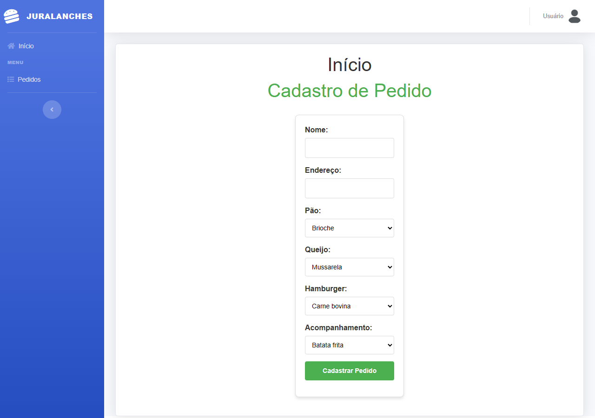
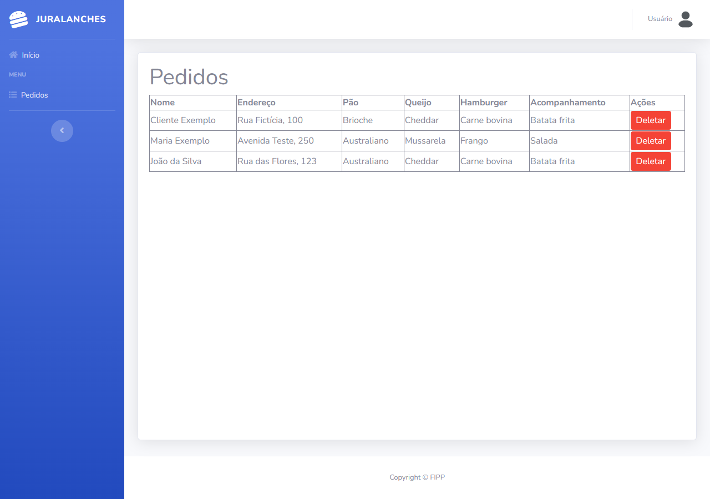

# Juralanches — Pedidos de lanchonete (MVC)

> Atividade de MVC com Express, EJS e MySQL: montar um pedido escolhendo pão, queijo, hambúrguer e acompanhamento, listar os pedidos e excluí-los.

**EN:** A small MVC exercise built with Express, EJS and MySQL. It lets the user assemble a burger order
from four catalog tables, list all orders and delete them.



## Sobre

Atividade do **1º bimestre** da disciplina de **Programação Fullstack I** do curso de **ADS — FIPP/Unoeste**.
O objetivo era ter o primeiro contato com a arquitetura MVC em uma aplicação web com cadastro e exclusão de
pedidos, usando MySQL local.

O pedido é montado a partir de quatro tabelas de catálogo (`tb_pao`, `tb_queijo`, `tb_hamburguer` e
`tb_acompanhamento`) e gravado em `tb_pedido` com as chaves estrangeiras de cada escolha. A listagem faz
`JOIN` nas quatro tabelas para mostrar as descrições.

## Funcionalidades

- Cadastro de pedido com nome, endereço e as quatro opções de montagem.
- Listagem dos pedidos com as descrições vindas do banco.
- Exclusão de pedido com confirmação no navegador.
- Envio do formulário por `fetch`, sem recarregar a página.

## Tecnologias

- Node.js 18+
- Express 4.18.2
- EJS 3.1.8 com `express-ejs-layouts` 2.5.1
- MySQL 8 (driver `mysql2` 3.1.2)
- dotenv 17.x
- Bootstrap e sb-admin-2 no layout (arquivos locais em `public/`)

## Arquitetura

```
jurandir-lanches-pfs1/
├── server.js                  # configura Express, EJS, layout e rotas
├── routes/
│   ├── homeRoute.js           # GET / e POST /cadastrar
│   └── pedidoRoute.js         # GET /pedido e POST /pedido/deletar/:id
├── controllers/
│   ├── homeController.js      # carrega os catálogos e cadastra o pedido
│   └── pedidoController.js    # lista e exclui pedidos
├── models/
│   ├── paoModel.js            # SELECT em tb_pao
│   ├── queijoModel.js         # SELECT em tb_queijo
│   ├── hamburguerModel.js     # SELECT em tb_hamburguer
│   ├── acompanhamentoModel.js # SELECT em tb_acompanhamento
│   └── pedidoModel.js         # INSERT, SELECT com JOIN e DELETE em tb_pedido
├── utils/database.js          # pool MySQL com helpers de query
├── views/
│   ├── layout.ejs             # menu lateral e estrutura das páginas
│   ├── Home/index.ejs         # formulário de cadastro
│   └── Pedido/listagem.ejs    # tabela de pedidos
├── public/                    # CSS, JS e imagens estáticas
└── database/schema.sql        # schema reconstruído do código + dados fictícios
```

O fluxo é o clássico MVC: a rota chama o controller, o controller usa os models e renderiza a view EJS.
O acesso ao banco fica concentrado em `utils/database.js`.

## Como rodar

### Pré-requisitos

- Node.js 18 ou superior
- MySQL 8

### Banco de dados

```bash
mysql -u root -p < database/schema.sql
```

O script cria o banco `jurandir`, as cinco tabelas e alguns registros **fictícios**. O schema foi
reconstruído a partir dos models e das queries do projeto, porque o original não estava no repositório.

### Variáveis de ambiente

Copie `.env.example` para `.env`:

| Variável | Para que serve | Exemplo |
| --- | --- | --- |
| `PORT` | Porta do servidor | `5000` |
| `DB_HOST` | Host do MySQL | `127.0.0.1` |
| `DB_PORT` | Porta do MySQL | `3306` |
| `DB_NAME` | Nome do banco | `jurandir` |
| `DB_USER` | Usuário do banco | `root` |
| `DB_PASSWORD` | Senha do banco | vazio no ambiente local |

### Instalação e execução

```bash
npm install
npm start        # ou: npm run dev
```

Acesse `http://localhost:5000`. As páginas ficam em `/` (cadastro) e `/pedido` (listagem).

## Uso / API

| Rota | Método | O que faz |
| --- | --- | --- |
| `/` | GET | Formulário de cadastro com os catálogos |
| `/cadastrar` | POST | Grava o pedido e responde `201` em JSON |
| `/pedido` | GET | Lista os pedidos |
| `/pedido/deletar/:id` | POST | Exclui o pedido e responde `{ ok, msg }` |

Os dados do pedido são enviados em JSON:

```json
{
  "nome": "João da Silva",
  "endereco": "Rua das Flores, 123",
  "pao_id": 2,
  "que_id": 2,
  "ham_id": 1,
  "aco_id": 1
}
```

## Telas



## Testes

O projeto não tem testes automatizados. A verificação manual é cadastrar um pedido, conferir a linha na
listagem e excluí-la.

## Deploy

Não há deploy público; o projeto foi feito para rodar com MySQL local.

## O que aprendi

<!-- TODO: pedir ao Thiago de 3 a 5 aprendizados técnicos deste projeto -->

## Licença

Distribuído sob a licença MIT. Veja [LICENSE](LICENSE).

## Autor

Thiago Enrico Costa Cardoso — [LinkedIn](https://www.linkedin.com/in/thiago-enrico-costa-cardoso/) · [Portfólio](https://teccdev.com.br/)
